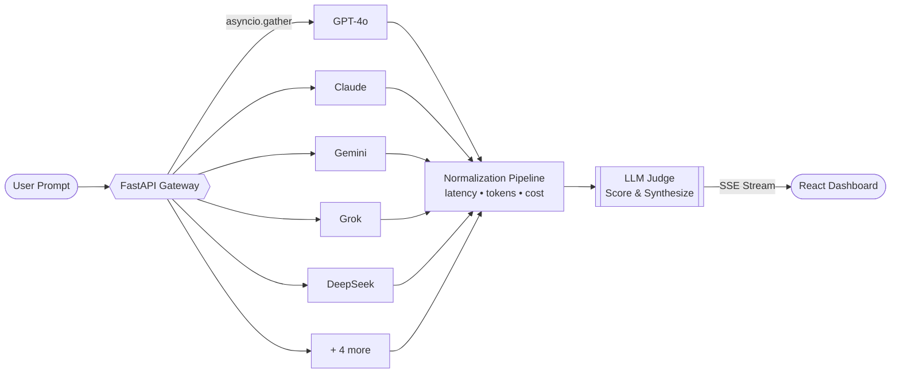
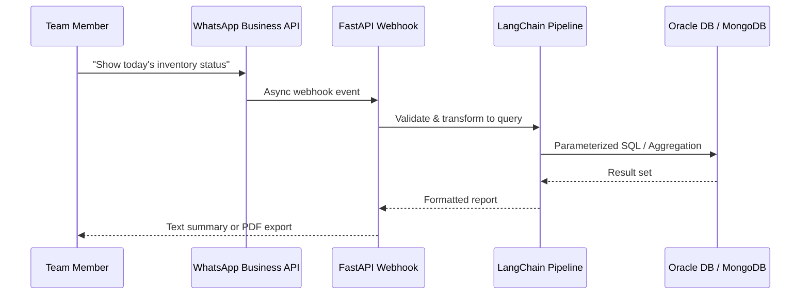

<!-- ============================================================
     GitHub Profile README — Muhammad Mohtashim
     Place this file in a public repo named exactly: mohtashim42
     ============================================================ -->

<div align="center">


<a href="https://github.com/mohtashim42">
  
</a>

<br/>

[](https://linkedin.com/in/themohtashimafzal)
[](mailto:mohtashimbhatti425@gmail.com)
[](https://www.upwork.com)
[](https://github.com/mohtashim42)

</div>

---

## 👨‍💻 About Me

I am a **Software Engineer with 3+ years of experience** building web applications, enterprise microservices, and multi-model AI integrations. My work spans the JavaScript/TypeScript and Python ecosystems, and I have delivered **over 15 production e-commerce platforms and SaaS systems**, with a consistent focus on clean code, efficient database design, and high API performance.

```ts
const mohtashim = {
  role:      "Software Engineer — Full Stack & AI",
  currently: "Software Engineer @ Rajco Industries",
  location:  "Pakistan 🇵🇰",
  education: "BS Computer Science — University of Sialkot",
  focus:     ["Full Stack Systems", "LLM Orchestration", "Enterprise Microservices"],
  freelance: "Upwork Top-Rated • 5★ • 100% Client Satisfaction",
  openTo:    ["Remote roles", "Technical collaboration", "Freelance engagements"],
};
```

---

## 📊 At a Glance

<div align="center">

| 🚀 **15+** | ⏱️ **3+ Years** | ⚡ **< 200ms** | 🤖 **9 LLMs** | ⭐ **5.0** |
|:---:|:---:|:---:|:---:|:---:|
| Production platforms shipped | Professional experience | Response time on core endpoints | Orchestrated concurrently | Upwork rating |

</div>

---

## 🧰 Technology Stack

<div align="center">

**Languages & Backend**


**Frontend & Mobile**


**Databases, Cloud & DevOps**


</div>

<details>
<summary><b>📚 Full competency overview</b></summary>
<br/>

| Domain | Expertise |
|---|---|
| **Engineering** | System Design, REST APIs, Microservices, E-Commerce Systems |
| **AI & Integration** | LLM API Integration (OpenAI, Gemini, Claude), Multi-LLM Orchestration, SSE Streaming, Async Fan-out, RAG, LangChain, WhatsApp AI Integration |
| **Frontend & Mobile** | React.js, Next.js, React Native (Expo), Redux Toolkit, Zustand, Shadcn UI, Material-UI |
| **Data** | PostgreSQL, MongoDB, Oracle DB, SQL Server, Redis, Supabase |
| **Real-Time** | WebSockets (Socket.io), Redis Pub/Sub |
| **DevOps** | Docker, CI/CD, AWS (EC2, S3), Vercel, Render |

</details>

---

## 🚀 Featured Projects

### 🧠 Orchestrator AI — Multi-LLM Gateway & Evaluation System
> A high-throughput AI gateway that fans a single prompt out to **9 LLM providers concurrently** and uses a 10th model as an impartial judge.

`FastAPI` `Python` `asyncio` `SSE Streaming` `React`

- Dispatches prompts concurrently to GPT-4o, Claude, Gemini, Grok, DeepSeek, and other providers using `asyncio.gather`.
- Normalizes per-provider metrics (latency, token usage, cost) into a unified log.
- Employs a dedicated **Judge model** to score responses and synthesize a final answer, streamed live to a React dashboard via Server-Sent Events.



📁 **Repository:** [`mohtashim42/orchestrator-ai`](https://github.com/mohtashim42/orchestrator-ai)

---

### 💬 Rajco AI Data Assistant — WhatsApp AI Bot & Enterprise BI System
> A conversational business-intelligence layer that allows internal teams to query live operational data in plain English through WhatsApp.

`FastAPI` `Node.js` `LangChain` `WhatsApp Business API` `Oracle DB` `MongoDB`

- Converts natural-language prompts into SQL and MongoDB aggregation queries through **secure, injection-resistant pipelines**.
- Delivers scheduled daily production summaries and critical inventory alerts to executives automatically.
- Uses asynchronous webhooks to return multi-format responses, including dynamic text reports and PDF exports.



📁 **Repository:** [`mohtashim42/rajco-ai-assistant`](https://github.com/mohtashim42/rajco-ai-assistant)

---

### 🛒 Cerova — Kitchen & Home Accessories E-Commerce Platform
> A complete multi-interface commerce solution covering the storefront, administration, and client management.

`Next.js` `React` `TypeScript` `Node.js` `Express` `MongoDB` `Tailwind CSS` `Docker`

- Delivers three tailored interfaces: **Admin Dashboard**, **Customer Storefront**, and **Client Portal**.
- Implements product catalog management, order processing, inventory tracking, and payment gateway integration.

📁 **Repository:** [`mohtashim42/cerova`](https://github.com/mohtashim42/cerova)

---

### 📱 Enterprise Production Planning App — React Native
> A mobile application for order tracking and factory production planning with hands-free voice controls.

`React Native` `React Native Voice` `Node.js` `NestJS` `Oracle DB`

- Introduced voice-driven input, **reducing manual data-entry time by 35%**.
- Backed by secure services featuring JWT authentication and role-based access control.

> 🔒 *Developed for Rajco Industries; source code is proprietary.*

---

## 💼 Professional Experience

<table>
<tr>
<td width="140"><b>Aug 2025 — Present</b></td>
<td>

**Software Engineer** · *Rajco Industries*<br/>
Built Rajco AI (internal LLM system and WhatsApp bot), a voice-enabled React Native app, and full-stack services with NestJS and FastAPI. Authored optimized SQL and aggregation pipelines on Oracle DB for daily executive reporting.

</td>
</tr>
<tr>
<td><b>Jul 2023 — Sep 2025</b></td>
<td>

**MERN Stack Developer** · *SyncOps*<br/>
Developed REST APIs and microservices with sub-200ms core response times, real-time messaging with Socket.io and Redis, LLM-powered data extraction workflows, and Dockerized deployments on AWS, Vercel, and Render.

</td>
</tr>
<tr>
<td><b>Aug 2021 — Present</b></td>
<td>

**Software Engineer & Full Stack Developer** · *Upwork (Top-Rated)*<br/>
Delivered end-to-end web applications, e-commerce stores, and client portals while maintaining a 5-star rating and 100% client satisfaction.

</td>
</tr>
</table>

---

## 📈 GitHub Analytics

<div align="center">


<br/>


<br/><br/>


</div>

---

## 🎯 Engineering Principles

- **Clean, maintainable code** — readable systems outlast clever ones.
- **Performance by design** — efficient schemas and lean APIs from the first commit.
- **Security first** — authentication, access control, and injection-safe data layers as defaults.
- **Production mindset** — containerized, deployed, and monitored, not merely demonstrated.

---

## 🤝 Let's Connect

I welcome conversations about full-stack engineering, AI integration, and impactful product development. Whether it is a full-time opportunity, a freelance engagement, or a technical collaboration, feel free to reach out.

<div align="center">

[](https://linkedin.com/in/themohtashimafzal)
[](mailto:mohtashimbhatti425@gmail.com)

<br/>

<i>“Engineering reliable systems, one commit at a time.”</i>


</div>
